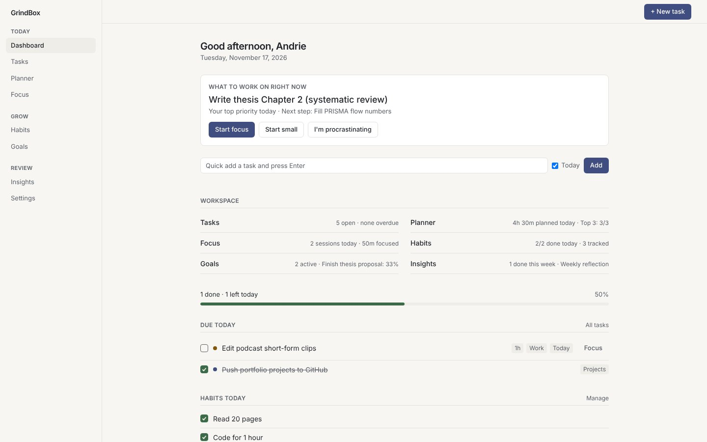
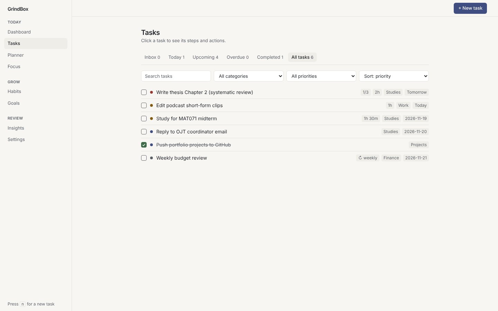
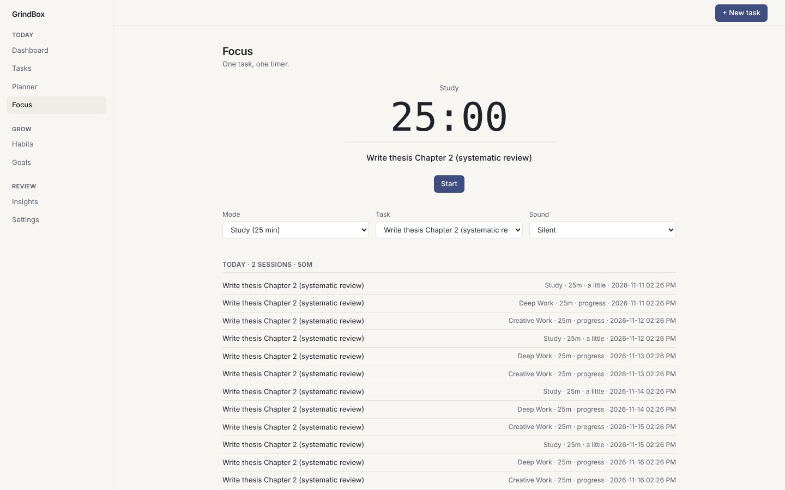
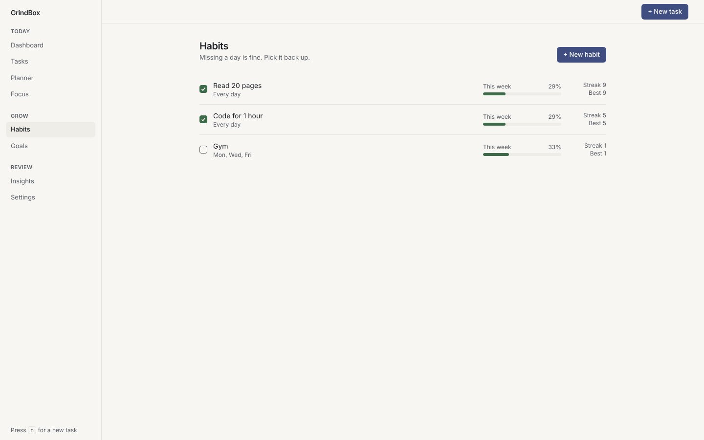
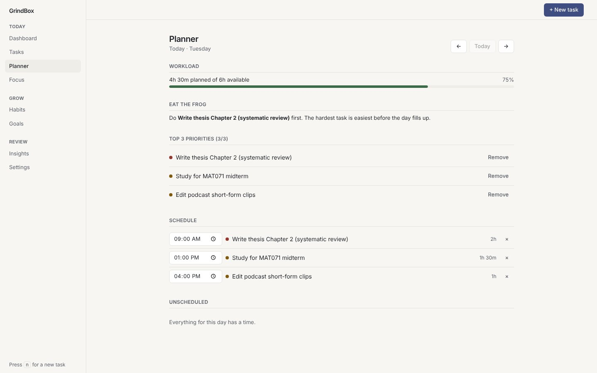
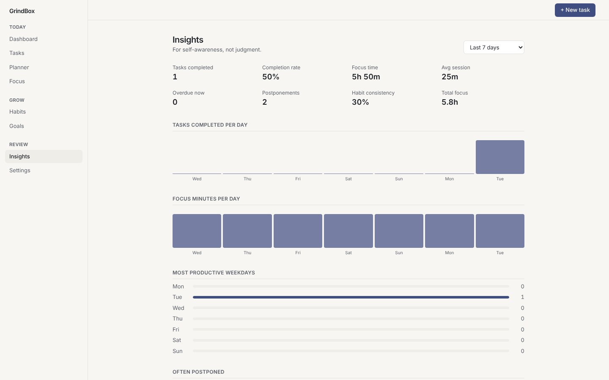
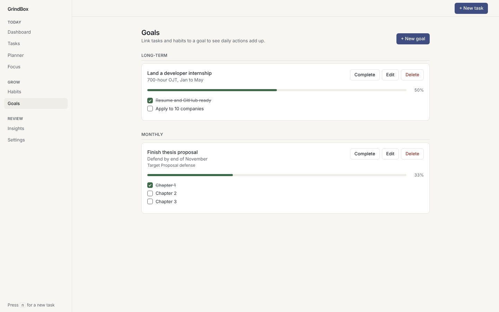

# GrindBox

A personal workspace for starting the things you keep avoiding: tasks with step breakdowns, a procrastination assistant, a focus timer, habits, a daily planner, goals and weekly insights.



## Features

- **Dashboard:** picks the one task to work on now, with quick add and today's habits.
- **Tasks:** priorities, categories, due dates, subtasks, estimates, recurring tasks and reminders.
- **Procrastination help:** "Start small" and "I'm procrastinating" break a task into a first step and log why it was postponed.
- **Focus timer:** Pomodoro-style sessions (25/5/15 by default) linked to a task, with a session log.
- **Habits:** daily or chosen-day schedules with current and best streaks.
- **Planner:** top 3 priorities, an "eat the frog" pick and a time-blocked schedule against available hours.
- **Goals:** milestones and progress, linked to tasks and habits.
- **Insights:** completion rate, focus minutes per day, habit consistency and most-postponed tasks.

## Tech Stack

| Area | Tools |
|------|-------|
| Framework | Next.js 16 (App Router), React 19 |
| Language | TypeScript |
| Styling | Tailwind CSS 4 |
| Storage | Browser `localStorage` (no backend) |

## Run

```bash
npm install
npm run dev      # http://localhost:3000
npm run build && npm start
```

## Screenshots

Screens below use sample data.

| Tasks | Focus |
|-------|-------|
|  |  |

| Habits | Planner |
|--------|---------|
|  |  |

| Insights | Goals |
|----------|-------|
|  |  |

## Notes

- All data is stored in this browser (`localStorage`, key `grindbox:v1`). There is no account or sync. Use Settings → Export data for backups.
- To add a real backend, replace the state and persistence in `src/lib/store.tsx`. Every page reads and writes through `useApp()`.
- "Suggest steps" and "Start small" use keyword templates, not AI. Suggestions are always editable before saving.
- Browser notifications are optional. Reminders also appear as an in-app banner while the app is open.
